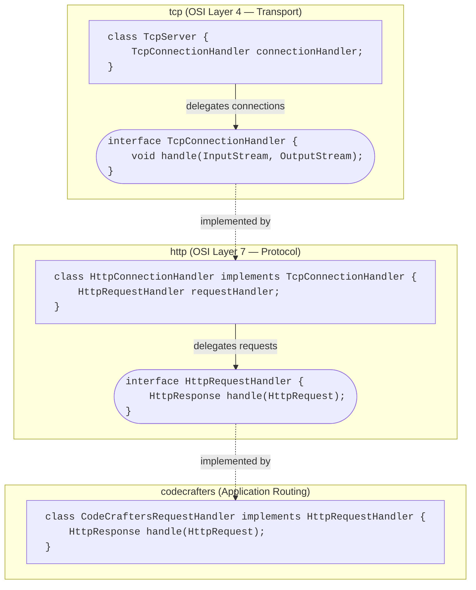

# HTTP Server in Java

An HTTP/1.1 server built from scratch in Java 25. Originally started as a solution to the
["Build Your Own HTTP server" Challenge](https://app.codecrafters.io/courses/http-server/overview)
by [codecrafters.io](https://codecrafters.io). Refactored into a layered architecture
separating TCP, HTTP/1.1, and application-layer routing.

## Architecture

This project is separated into 3 layers:

- **TCP**: The `tcp` package implements the TCP layer (OSI Layer 4), which can be reused with other OSI Layer 7 protocols (e.g. Redis or Kafka in other CodeCrafters challenges).
- **HTTP/1.1**: The `http` package implements part of the HTTP/1.1 protocol.
- **Application-layer routing**: The `codecrafters` package implements the custom routing and logic of the CodeCrafters challenge.

The 3 layers are connected using the [Strategy](https://en.wikipedia.org/wiki/Strategy_pattern) pattern:
- Each `TcpServer` instance contains a `TcpConnectionHandler`, which is an HTTP handler for this project, but can also be swapped out for a different protocol (e.g. a Redis or Kafka handler).
- Each `HttpConnectionHandler` instance contains an `HttpRequestHandler`, which contains the specific routing and logic of a server.

The diagram below showcases the overall architecture:

